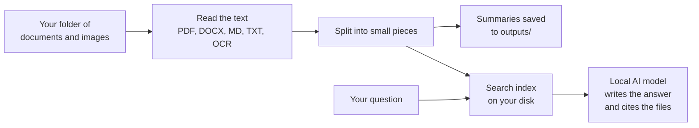

# Local AI Assistant


> Point it at a folder of documents and it will summarise them and answer your
> questions about them, using an AI model that runs entirely on your own computer.

## In plain terms

**The problem.** You have a folder full of reports, notes and scanned pages and
no time to read them all. Online AI tools could help, but uploading work
documents to someone else's server is often not allowed.

**What this does.** It reads the files in a folder (PDF, Word, Markdown, plain
text, and text inside images), writes a short bullet-point summary of each one,
and lets you ask questions such as *"What does the report say about sales?"*.
Each answer lists the files it came from, so you can check it.

**Why it is different.** Nothing is uploaded. The language model runs locally
through [Ollama](https://github.com/ollama/ollama), and the search index is
stored on disk with [Chroma](https://www.trychroma.com/).

## How it works



In technical terms this is a retrieval-augmented generation (RAG) pipeline with
a command-line interface, written in Python.

## Features

### 📄 Summarise Documents

- Supports **PDF**, **DOCX**, **Markdown**, and **plain text** files.
- Extracts text, splits it into manageable chunks, and generates clear
  bullet‑point summaries using a local language model.
- Writes summaries to a dedicated `outputs/` folder alongside the
  original file name (e.g. `report.pdf.summary.md`).

### 🖼️ Image OCR

- Basic **OCR** using Tesseract via `pytesseract` for **PNG** and **JPG**
  images.
- Treats extracted text from images like a document so it can be
  summarised and indexed.
- Placeholder for vision‑enabled models if you wish to add richer image
  descriptions.

### 🔎 Retrieval‑Augmented QA

- Ingest your folder into a **vector store**. Each document is split
  into chunks, embedded, and stored with metadata about the source
  file.
- Ask natural language questions over your ingested data. The assistant
  retrieves relevant chunks and answers using them as context.
- Provides citations by listing the file paths used to answer the
  question.

## Installation

1. **Clone** this repository or copy the `ai-assistant` folder into your
   workspace.
2. Install Python 3.10 or newer.
3. Install the required packages:

   ```bash
   cd ai-assistant
   pip install -e .
   # or, if you prefer a requirements.txt style:
   # pip install -r requirements.txt
   ```

4. [Install Ollama](https://github.com/ollama/ollama#installation) and
   ensure it is running (`ollama serve`). Pull a language model such as
   `llama3`:

   ```bash
   ollama pull llama3
   ```

5. Optional: install
   [Tesseract](https://github.com/tesseract-ocr/tesseract#installing-tesseract)
   on your system and ensure it is in your `PATH` if you plan to use
   OCR.

## Usage

From the root directory, run the CLI via `main.py`:

```bash
# Run unit tests
python -m unittest discover

# Summarise all supported files in a folder
python main.py summary --folder ./data

# Summarise a single file
python main.py summary --file ./data/report.pdf

# Ingest a folder into the vector store for RAG
python main.py ingest --folder ./data

# Ask a question over the ingested documents
python main.py ask --question "What does the report say about sales?"
```

### Troubleshooting

- Ensure Ollama is running (`ollama serve`) and the target model (e.g. `llama3`) is pulled; otherwise summarisation and QA commands will fail with a connection error.
- If OCR is required, confirm Tesseract is installed and available on the `PATH`.

### Configuration

The assistant reads settings from `config.yaml`. You can adjust:

- **model**: Name of the Ollama model and sampling temperature.
- **rag**: Embedding model (placeholder), number of top results, chunk size and overlap.
- **paths**: Data, output, and vector store directories.
- **logging**: Log level.

## Project Layout

| Path                           | Purpose                                     |
|--------------------------------|---------------------------------------------|
| `config.yaml`                  | User‑configurable settings                  |
| `main.py`                      | CLI entry point                             |
| `assistant/config.py`          | Configuration loader                        |
| `assistant/cli.py`             | Argument parser and subcommand dispatcher   |
| `assistant/file_discovery.py`  | Discover and filter files                   |
| `assistant/chunking.py`        | Simple text chunking                        |
| `assistant/llm/ollama_client.py`| Wrapper for Ollama API                      |
| `assistant/parsers/`           | Modules to extract text from various formats|
| `assistant/summarizer.py`      | Summary routines                            |
| `assistant/rag.py`             | Retrieval‑augmented QA routines             |

## Extending the Assistant

- **Vision models**: Integrate a vision‑enabled Ollama model to replace or
  supplement the OCR path in `assistant/parsers/image_parser.py`.
- **Token‑based chunking**: Replace the simple character chunker in
  `assistant/chunking.py` with a tokenizer (e.g. from HuggingFace) for
  more precise splitting.
- **Embeddings**: Swap the placeholder embedding model name in
  `config.yaml` and `rag.py` for an actual local embedding model via
  Ollama or another library.
- **Web or GUI**: Build a web front‑end with Flask or FastAPI, or a
  Streamlit/Gradio interface for interactive use.

## Status

Version 0.1.0. A working command-line tool; there is no web or desktop interface
yet. Answer quality depends on the local model you choose.

## License

This project is provided for educational purposes without any warranty.
